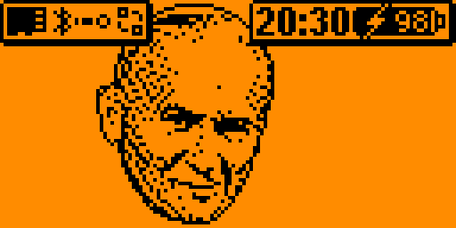
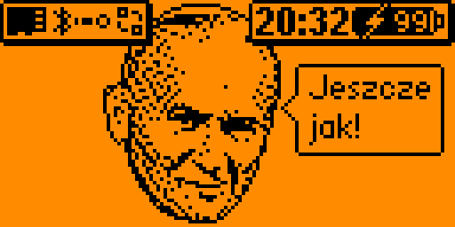
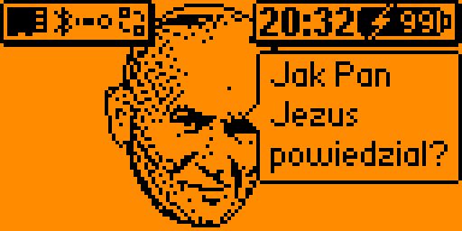
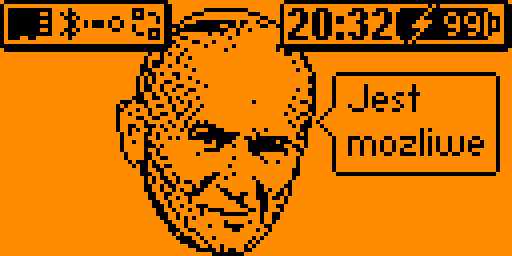

# Papież na Flipperze

Pakiet zasobów (asset pack) dla firmware **Momentum** na Flipper Zero: zamiast
delfina na pulpicie pojawia się portret papieża. Papież lekko kiwa głową, a po
naciśnięciu przycisku na pulpicie albo po powrocie na pulpit z menu mówi jeden
z tekstów, wybierany losowo.



*Zrzut ekranu z Flippera z firmware Momentum.*

## Co mówi papież

| | |
|---|---|
|  |  |
|  | |

*Zrzuty ekranu z Flippera.*

Wszystkie teksty:

- Jeszcze jak!
- Z warkoczykami czy bez?
- nie wiem
- Jest możliwe
- Jak Pan Jezus powiedział?
- Okrutnik!
- Tak Pan Jezus powiedział
- A można, jak najbardziej.


*Wszystkie dymki narysowane fontem Flippera (symulacja, pasek statusu wzięty ze
zrzutu ekranu).*

Fonty Flippera nie mają polskich znaków, dlatego na ekranie jest „mozliwe”
i „powiedzial”.

## Instalacja

1. Skopiuj folder `asset_packs/Papiez` na kartę microSD Flippera do
   `/ext/asset_packs/` (np. przez qFlipper: zakładka plików, SD Card,
   `asset_packs`). Docelowo ma powstać `/ext/asset_packs/Papiez/Anims/manifest.txt`.
2. Na Flipperze otwórz aplikację **Momentum** i przejdź do
   **Interface → Graphics → Asset Pack**. Wybierz **Papiez**.
3. Wyjdź z ustawień. Jeśli Flipper poprosi o restart, zgódź się.

Żeby wrócić do delfina, ustaw w tym samym miejscu Asset Pack na **Default**.

## Kiedy papież mówi

- Po naciśnięciu dowolnego przycisku na pulpicie. Najbezpieczniej krótko
  nacisnąć **Wstecz** - na pulpicie nic innego nie robi. Pozostałe przyciski
  dalej otwierają menu, blokadę, pliki i ulubione aplikacje.
- Po powrocie na pulpit z menu albo z aplikacji.
- Dymek wisi ok. 4 sekund, a następny może się pojawić po 3 sekundach przerwy.
  Bez naciskania przycisków papież tylko kiwa głową.

## Uwagi

- Papież stoi w luce między dwiema częściami paska statusu: ikonami po lewej
  i zegarem z baterią po prawej. Boki czoła mogą lekko wchodzić pod pasek, twarz
  zostaje odsłonięta. Jeśli w ustawieniach Momentum włączysz tło paska statusu na
  całą szerokość, zakryje ono czubek głowy.
- Pakiet zmienia tylko animację pulpitu. Paszport i inne ekrany dalej pokazują
  delfina.
- Pakiet działa tylko na firmware Momentum. Oficjalne firmware nie obsługuje
  pakietów zasobów.

## Budowanie

Gotowy pakiet leży w `asset_packs/`. Po zmianie portretu albo tekstów zbuduj go
ponownie (wystarczy Python 3, bez dodatkowych bibliotek):

```sh
python3 zbuduj.py
```

Skrypt tworzy `asset_packs/Papiez` i odświeża `podglad.png` (obie klatki
animacji obok siebie).

### Zmiana tekstów

Teksty są na liście `TEKSTY` na początku `zbuduj.py`. Można pisać z polskimi
znakami - skrypt zamieni je na łacińskie. `\n` łamie linię. Skrypt sam ustawia
dymek przy twarzy, a testy sprawdzają, czy każdy mieści się na ekranie.

### Zmiana portretu

Portret leży w `papiez.txt`: 64 wiersze po 52 znaki, `#` to czarny piksel,
`.` to tło. Pierwszy i ostatni wiersz muszą zostać puste, bo druga klatka jest
przesunięta o 1 piksel w dół.

## Testy

```sh
python3 -m unittest -v
```

Testy sprawdzają format plików `.bm` (kolejność bitów, rozmiar w limicie
firmware), zgodność `meta.txt` z klatkami według reguł parsera Momentum oraz to,
czy każdy dymek mieści się na ekranie pod paskiem statusu.

## Licencja

MIT - szczegóły w pliku [LICENSE](LICENSE).
